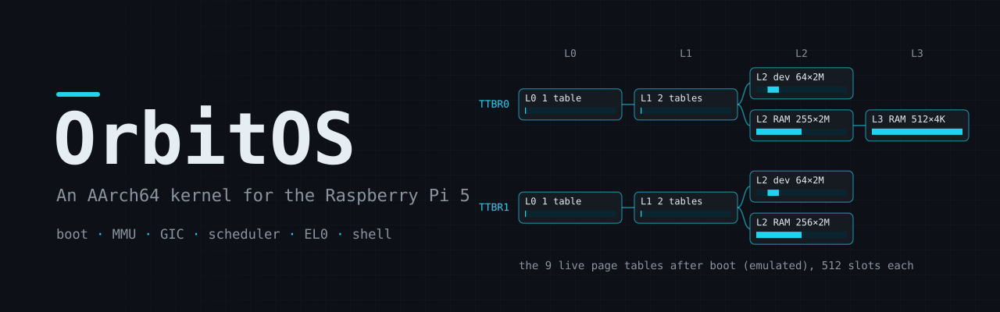
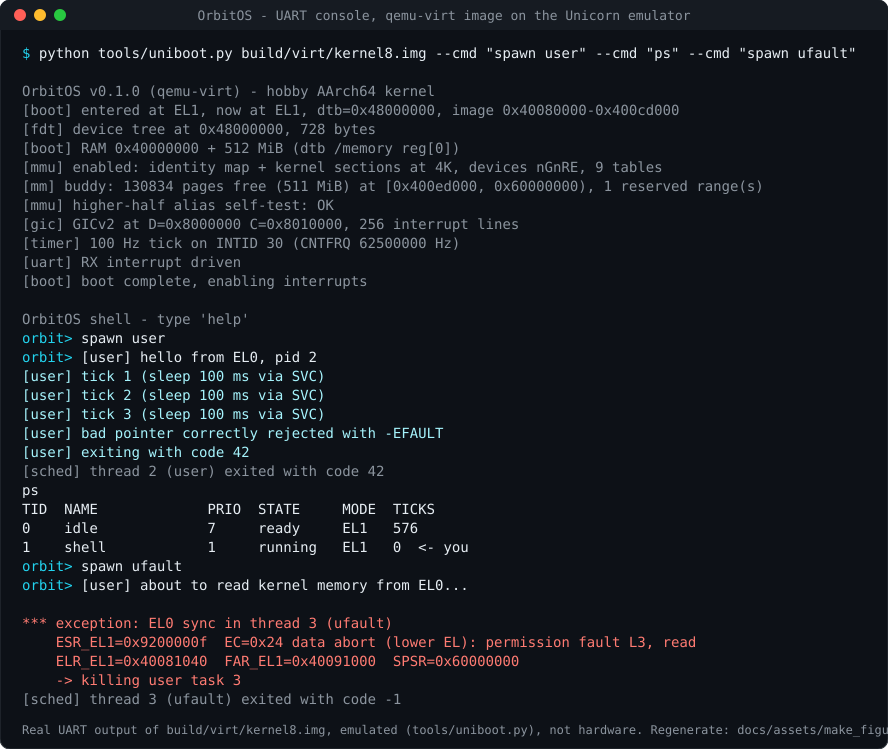
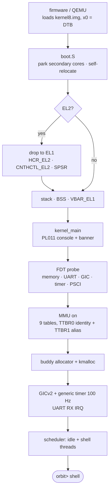
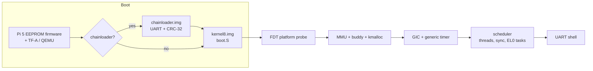
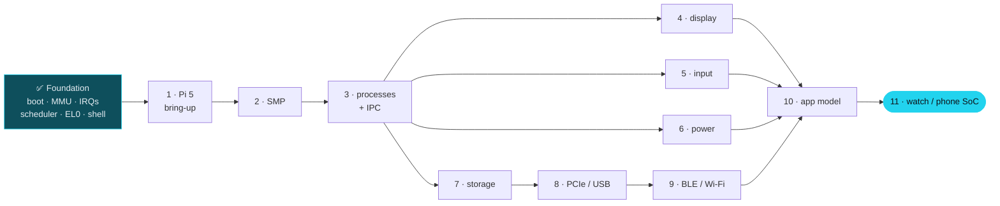

<p align="center">
  
</p>

<p align="center">
  <a href="https://github.com/coopersimpson101-debug/orbit-os/actions/workflows/ci.yml"></a>
[](https://github.com/coopersimpson101-debug/orbit-os/releases/latest)
  <a href="LICENSE"></a>
  
  
  
</p>

**A from-scratch AArch64 kernel for the Raspberry Pi 5 - and the foundation for a
phone and smartwatch OS of our own.** Phones and watches share the same core
hardware (ARMv8 cores, a GIC, a generic timer, a PL011-class UART); OrbitOS builds
that common base first, on a board you can buy and probe and on an emulator that CI
boots on every commit.

<p align="center">
  <a href="#quick-start">Quickstart</a> ·
  <a href="#architecture">How it works</a> ·
  <a href="#status">Results</a> ·
  <a href="#roadmap-from-kernel-to-phone-and-watch-os">Roadmap</a>
</p>

<p align="center">
  
</p>
<p align="center"><sub>Real UART output of <code>build/virt/kernel8.img</code> on the Unicorn-based emulator
(<code>tools/uniboot.py</code>) - <b>emulated, not hardware</b>. Unicorn starts at EL1; under QEMU with
<code>virtualization=on</code> (CI) the banner reads <code>entered at EL2, now at EL1</code>.
Regenerate with <code>python docs/assets/make_figures.py</code>.</sub></p>

## Highlights

- **Boots to a shell in ~4.7k lines of C and assembly**, no libc, no third-party code: a 67 KB `kernel8.img` for each board.
- **Real MMU setup:** 4 KiB granule, 48-bit VA, 4-level tables (9 of them at boot), device/normal memory types, W^X kernel sections (text read-only + executable, data XN), EL0/EL1 split and a higher-half alias in TTBR1.
- **Preemptive scheduler:** 8 priority levels, 50 ms slices driven by the 100 Hz generic timer, semaphores and mutexes; the `spin` demo proves preemption.
- **User mode with isolation:** EL0 tasks make SVC syscalls; bad user pointers get `-EFAULT`, and an EL0 fault kills the task, not the kernel.
- **UART chainloader** with a length + CRC-32 framed protocol, so new kernels can be sent over serial without touching the SD card.
- **Booted in CI on every push** under QEMU `virt` (direct and chainloaded, entering at EL2) with both zig/LLVM and GNU cross-gcc builds, plus the host tests.
- **64-bit RISC-V port (`rv64`)** for the orbit-rv SoC and QEMU riscv64 `virt`: RV64IMA only (no compressed or FP instructions), the whole system in 256 KiB of RAM, M-mode entry with its own [SBI shim](docs/sbi.md) instead of OpenSBI, Sv39 with W^X sections, PLIC + 16550, U-mode tasks via `ecall`. Same scheduler, shell and demos as the Arm boards.

## Status

| | what | how it was checked |
|---|---|---|
| ✅ | Builds for `virt` and `rpi5` with zig cc / ld.lld, `-Werror` | locally (Windows) and in CI |
| ✅ | `rv64` builds (RV64IMA_Zicsr_Zifencei, no RVC, 116 KiB of the 256 KiB RAM incl. BSS and stacks), `-Werror` | locally (Windows) and in CI |
| ✅ | 11 C unit-test programs (incl. scause decoder, Sv39 PTE builder) + image/layout checks | locally and in CI |
| ✅ | `Makefile` build with GNU `aarch64-linux-gnu-gcc` | CI (`make-gcc` job) |
| 🧪 | QEMU `virt` boot: direct `-kernel` (EL2→EL1 drop) and via the UART chainloader, full scripted shell session | CI, QEMU (emulated) |
| 🧪 | Boot, chainloader, EL0, faults and preemption on Unicorn (`tools/uniboot.py`) | locally, approximate machine model |
| 🧪 | `rv64` boot on the orbit-rv golden ISS: shell, preemption, U-mode syscalls, fault isolation, SBI poweroff (`tools/iss_test.py`) | locally, instruction-accurate simulator (see [testing](docs/testing.md#2b-orbit-rv-golden-iss-toolsiss_testpy-optional)) |
| 🧪 | `rv64` QEMU riscv64 `virt` boot (`-bios none`), full scripted shell session | CI, QEMU (emulated) |
| 🧪 | `rv64` boot on the **orbit-rv RTL** (CXXRTL simulation of the pipelined core, 25 MHz model, 256 KiB RAM): banner, shell, preemption, U-mode syscalls, fault isolation, poweroff; all 5,978,340 commits and traps checked against the golden ISS | in the orbit-rv repo: `tools/boot_os.py` |
| ⏳ | **orbit-rv FPGA boot** (ULX3S) - bitstream builds with the yowasp tools; board run not yet done | orbit-rv `docs/fpga.md` |
| ⏳ | **Raspberry Pi 5 hardware boot** - not yet attempted | [hardware validation checklist](docs/hardware-validation.md) |
| 🗺️ | GICv3, SMP, per-process address spaces, filesystem, display, input, USB, radios | [roadmap](#roadmap-from-kernel-to-phone-and-watch-os) |

Known limitations: single core. All threads share one address space. Slab
pages are never returned to the buddy allocator. Strict priorities can starve
lower levels. On the Pi 5, the PL011 baud rate is left as the firmware set it.
RAM above the first DTB memory bank and above 4 GiB is ignored.

## What's in the box

| Area | Implemented |
|------|-------------|
| **Boot** (`kernel/arch/aarch64/boot.S`) | Linux arm64 Image header, secondary-core parking (MPIDR Aff0-2, A72 and A76 layouts; PSCI keeps them off), self-relocation to the link address, EL2→EL1 drop (HCR_EL2, CNTHCTL_EL2, CPTR_EL2, SCTLR_EL1), stack, BSS, VBAR_EL1 |
| **Bootloader** (`chainloader/`, `tools/send_kernel.py`) | UART chainloader: relocates itself, receives a kernel with a length + CRC-32 framed protocol, and boots it with the firmware's DTB and EL. The Python sender works with a serial port or a TCP bridge to QEMU ([protocol](docs/chainloader-protocol.md)) |
| **Board support** | Pi 5 (BCM2712 debug-UART PL011 at `0x10_7d00_1000`, GIC-400) and QEMU `virt` (PL011 `0x0900_0000`, GICv2). Values come from compile-time defaults refined by a **minimal FDT parser** (memory, stdout-path/aliases, `ranges` translation, GIC, timer PPI, PSCI method, `/memreserve/`) |
| **Exceptions** | Full 16-entry vector table, 272-byte trap frames, ESR_EL1 decoder (class, fault status, level, WnR) with ELR/FAR dumps. A fault in a thread kills only that thread |
| **Interrupts** | GICv2/GIC-400 driver, ARM generic timer at 100 Hz, interrupt-driven PL011 RX |
| **Memory** | Buddy page allocator (4 KiB to 4 MiB), slab-style `kmalloc` (16 B to 1 KiB classes, page-backed large allocations), MMU with 4 KiB granule, 48-bit VA and 4-level tables, MAIR device/normal types, per-section permissions, EL0/EL1 split, higher-half linear alias in TTBR1 |
| **Scheduler** | Kernel threads, `cpu_switch` in assembly, 8-level priority round-robin with 50 ms slices and timer preemption, sleep/wake, semaphores, mutexes |
| **User mode** | EL0 tasks entered with `eret`. SVC syscalls `write`, `sleep`, `yield`, `exit`, `getpid` with user-pointer validation. EL0 faults kill the task, not the kernel |
| **Shell** | Line editing (backspace/DEL, Ctrl-U, Ctrl-C, ANSI escapes ignored), quoting. Commands: `help info mem ps uptime ticks echo peek poke spawn reboot poweroff`. `peek`/`poke` are guarded (alignment, mapped range, no writes into the kernel image). `reboot`/`poweroff` use PSCI |
| **Build** | `build.py` (zig cc + ld.lld + objcopy, hermetic via `pip install ziglang`), plus a `Makefile` for `aarch64-none-elf-gcc` / `aarch64-linux-gnu-gcc` |
| **Tests** | 11 C unit-test programs for the portable modules, run under pytest. Image and layout checks. Unicorn-based emulated boot, orbit-rv ISS boot. QEMU boot tests in CI |
| **RV64 port** (`kernel/arch/riscv64/`) | M-mode `boot.S` (PMP, `medeleg`/`mideleg`, `mcounteren`, `mret` to S), SBI shim (TIME `set_timer` + STIP forwarding, SRST via the finisher, BASE, legacy console), `stvec` trap frame and scause decoder, Sv39 identity map with W^X and pre-set A/D bits plus a higher-half alias, SBI timer at 100 Hz, PLIC + NS16550 with RX interrupts, `sret` into U-mode, `ecall` syscalls with `SUM`-guarded copies. Details: [architecture](docs/architecture.md#rv64-port), [memory map](docs/memory-map.md#rv64-orbit-rv-soc-qemu-riscv64-virt-subset), [SBI](docs/sbi.md) |

## Quick start

```sh
python -m venv .venv && . .venv/bin/activate       # Windows: .venv\Scripts\activate
pip install ziglang pytest pyelftools unicorn       # unicorn/pyelftools optional
python build.py                                     # -> build/{virt,rpi5}/kernel8.img, chainloader.img, build/rv64/kernel.elf
python -m pytest -q tests                           # host unit tests + emulated boot
```

With QEMU installed:

```sh
python tools/qemu_test.py                 # scripted boot test (what CI runs)
python tools/qemu_test.py --interactive   # use the shell yourself; Ctrl-A X to quit
# or by hand:
qemu-system-aarch64 -M virt,gic-version=2,virtualization=on -cpu cortex-a72 -m 512M \
    -nographic -kernel build/virt/kernel8.img
```

RISC-V (`rv64`):

```sh
python tools/qemu_test.py --board rv64             # needs qemu-system-riscv64 (qemu-system-misc)
qemu-system-riscv64 -M virt -bios none -m 128M -nographic -kernel build/rv64/kernel.elf
ORBIT_RV_PATH=../orbit-rv python tools/iss_test.py # on the orbit-rv golden ISS
```

On a Raspberry Pi 5, follow [docs/hardware-validation.md](docs/hardware-validation.md)
(SD card layout, `config.txt`, debug UART wiring).

Shell demos (`spawn <name>`):

| Demo | Shows |
|------|-------|
| `counter` | sleep/wake with timer ticks |
| `mutex` | two threads, 2000 locked increments with a yield inside the critical section |
| `pc` | producer/consumer with counting semaphores |
| `spin` | two CPU-bound threads that never yield: proves timer preemption |
| `user` | EL0 / U-mode task making syscalls, including a rejected bad pointer |
| `ufault` | EL0 / U-mode task reads kernel memory, gets a permission (page) fault, and is killed |
| `fault` | kernel thread touches an unmapped address, gets a translation fault, and is killed |

## Architecture

Boot flow, as printed on the UART above:



Component view:



Details: [docs/architecture.md](docs/architecture.md) (layers, boot sequence,
exception and scheduler design), [docs/memory-map.md](docs/memory-map.md)
(image layout, virt and Pi 5 address maps).

### Memory map (summary)

| | qemu-virt | Raspberry Pi 5 (expected) |
|---|---|---|
| RAM | `0x4000_0000` + size from DTB | `0x0` + size from DTB |
| Kernel link/load | `0x4008_0000` | `0x8_0000` |
| Chainloader runs at | `0x4200_0000` | `0x200_0000` |
| UART (PL011) | `0x0900_0000` | `0x10_7d00_1000` (debug header) |
| GIC distributor / CPU if. | `0x0800_0000` / `0x0801_0000` | `0x10_7fff_9000` / `0x10_7fff_a000` |
| Device window (nGnRE) | `0x0800_0000`-`0x1000_0000` | `0x10_7c00_0000`-`0x10_8000_0000` |
| Higher-half alias | `0xffff_0000_0000_0000 + PA` | same |

## Roadmap: from kernel to phone and watch OS

Each milestone keeps CI green on QEMU and gets validated on the Pi 5 before
the next one starts.



<details>
<summary><b>Milestones in detail</b></summary>


1. **Hardware bring-up on Pi 5.** Run through the validation checklist, fix
   whatever real silicon disagrees with, and add D-cache maintenance by set/way.
2. **SMP.** Bring up the other three A76 cores with PSCI `CPU_ON`, add per-CPU run
   queues, spinlocks, and IPIs through the GIC.
3. **Process model and IPC.** Per-process TTBR0 address spaces, an ELF loader,
   and capability-based synchronous IPC with shared-memory channels. Drivers
   move out of the kernel into user-space servers (microkernel direction). The
   kernel moves into the TTBR1 half, building on the existing higher-half alias.
4. **Display.** A simple framebuffer first (firmware mailbox / `simple-framebuffer`
   from the DTB), then a compositor server. After that, SPI/DSI panel drivers
   for small round or square watch displays.
5. **Input.** I2C touch controllers (for example FT6x36/CST816-class parts common on
   watch panels), GPIO buttons and a rotary crown, and an input event server.
6. **Power management** (critical for a watch). Tickless idle, WFI/PSCI
   `CPU_SUSPEND` low-power states, DVFS hooks, wake sources (RTC, buttons, IMU
   interrupts), and battery/fuel-gauge drivers.
7. **Storage.** SD/eMMC driver, a block cache, and a simple log-structured
   filesystem suited to flash and sudden power loss.
8. **PCIe + RP1.** This unlocks the Pi 5's GPIO UARTs, Ethernet and USB.
   **USB** host stack for HID and storage.
9. **Wireless.** Wi-Fi and BLE through an external module (or the Pi 5's
   CYW43455 over SDIO). BLE first, for watch-to-phone pairing.
10. **App model.** A sandboxed app runtime on top of IPC: manifest-declared
    capabilities, an event loop tied to the compositor and input servers, and a
    small UI toolkit sized for watch faces and phone screens.
11. **Ports.** Move to a dedicated wearable-class SoC once the abstractions above
    have proved themselves on the Pi.

</details>

## Repository layout

```
kernel/arch/aarch64   boot.S, vectors.S, switch.S, linker.ld.S, trap, mmu, cpu hooks
kernel/arch/riscv64   boot.S (M-mode), sbi.c (SBI shim), entry.S, switch.S, trap, mmu (Sv39), cpu hooks
kernel/core      main, console, clock, platform (FDT probe), syscalls, demos
kernel/drivers   pl011, gic (v2), timer + PSCI; ns16550, plic, sbi_timer; serial (shared RX ring)
kernel/mm        buddy, kheap, mm glue
kernel/sched     runqueue, scheduler, semaphores/mutexes
kernel/fdt       device-tree parser
kernel/shell     line editor/tokenizer, shell commands
kernel/user      the built-in EL0 program
kernel/board     board_virt.c, board_rpi5.c, board_rv64.c
chainloader/     UART chainloader
tools/           send_kernel.py, mkdtb.py, qemu_test.py, uniboot.py, iss_test.py, sessions.py
tests/           C unit tests + pytest driver
docs/            architecture, memory map, SBI shim, chainloader protocol, testing, hardware validation
```

## License

MIT. See [LICENSE](LICENSE).
