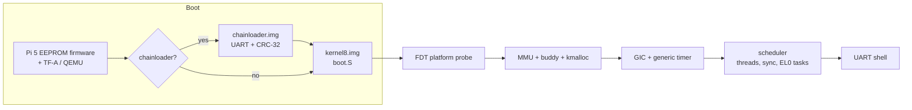

# OrbitOS

**A hobby AArch64 kernel for the Raspberry Pi 5, and the foundation for a
phone and smartwatch OS of our own.**

Phones and watches run on the same kind of hardware: ARMv8 cores, a GIC, a
generic timer, a PL011-class UART for bring-up, and very little else that you
can count on being the same. OrbitOS builds that common base first, on a board
you can buy and probe (the Pi 5) and on an emulator that CI can boot on every
commit (QEMU `virt`). It includes a bootloader, memory management, a preemptive
scheduler with user mode, and a shell. Displays, touch input, radios and power
management for wearables are added on top of that base, one roadmap item at a time.

> **Honest status:** OrbitOS builds for both boards and passes host unit tests
> and an emulated boot locally. QEMU boot tests are set up in CI. **It has not
> yet been booted on a real Raspberry Pi 5.** See
> [Status](#status) and [docs/hardware-validation.md](docs/hardware-validation.md).

```
OrbitOS v0.1.0 (qemu-virt) - hobby AArch64 kernel
[boot] entered at EL1, now at EL1, dtb=0x48000000, image 0x40080000-0x400cd000
[fdt] device tree at 0x48000000, 728 bytes
[mmu] enabled: identity map + kernel sections at 4K, devices nGnRE, 9 tables
[mm] buddy: 130834 pages free (511 MiB) at [0x400ed000, 0x60000000), 1 reserved range(s)
[mmu] higher-half alias self-test: OK
[gic] GICv2 at D=0x8000000 C=0x8010000, 256 interrupt lines
[timer] 100 Hz tick on INTID 30 (CNTFRQ 62500000 Hz)
OrbitOS shell - type 'help'
orbit> spawn user
[user] hello from EL0, pid 2
[user] tick 1 (sleep 100 ms via SVC)
...
[user] bad pointer correctly rejected with -EFAULT
[sched] thread 2 (user) exited with code 42
orbit> spawn ufault
*** exception: EL0 sync in thread 3 (ufault)
    ESR_EL1=0x9200000f  EC=0x24 data abort (lower EL): permission fault L3, read
    -> killing user task 3
```
<sub>The transcript above was captured from `tools/uniboot.py` (an emulated boot, see
[docs/testing.md](docs/testing.md)) and trimmed. Under QEMU with
`virtualization=on`, the banner reads `entered at EL2, now at EL1`.</sub>

## What's in the box

| Area | Implemented |
|------|-------------|
| **Boot** (`kernel/arch/boot.S`) | Linux arm64 Image header, secondary-core parking (MPIDR Aff0-2, A72 and A76 layouts; PSCI keeps them off), self-relocation to the link address, EL2→EL1 drop (HCR_EL2, CNTHCTL_EL2, CPTR_EL2, SCTLR_EL1), stack, BSS, VBAR_EL1 |
| **Bootloader** (`chainloader/`, `tools/send_kernel.py`) | UART chainloader: relocates itself, receives a kernel with a length + CRC-32 framed protocol, and boots it with the firmware's DTB and EL. The Python sender works with a serial port or a TCP bridge to QEMU ([protocol](docs/chainloader-protocol.md)) |
| **Board support** | Pi 5 (BCM2712 debug-UART PL011 at `0x10_7d00_1000`, GIC-400) and QEMU `virt` (PL011 `0x0900_0000`, GICv2). Values come from compile-time defaults refined by a **minimal FDT parser** (memory, stdout-path/aliases, `ranges` translation, GIC, timer PPI, PSCI method, `/memreserve/`) |
| **Exceptions** | Full 16-entry vector table, 272-byte trap frames, ESR_EL1 decoder (class, fault status, level, WnR) with ELR/FAR dumps. A fault in a thread kills only that thread |
| **Interrupts** | GICv2/GIC-400 driver, ARM generic timer at 100 Hz, interrupt-driven PL011 RX |
| **Memory** | Buddy page allocator (4 KiB to 4 MiB), slab-style `kmalloc` (16 B to 1 KiB classes, page-backed large allocations), MMU with 4 KiB granule, 48-bit VA and 4-level tables, MAIR device/normal types, per-section permissions, EL0/EL1 split, higher-half linear alias in TTBR1 |
| **Scheduler** | Kernel threads, `cpu_switch` in assembly, 8-level priority round-robin with 50 ms slices and timer preemption, sleep/wake, semaphores, mutexes |
| **User mode** | EL0 tasks entered with `eret`. SVC syscalls `write`, `sleep`, `yield`, `exit`, `getpid` with user-pointer validation. EL0 faults kill the task, not the kernel |
| **Shell** | Line editing (backspace/DEL, Ctrl-U, Ctrl-C, ANSI escapes ignored), quoting. Commands: `help info mem ps uptime ticks echo peek poke spawn reboot poweroff`. `peek`/`poke` are guarded (alignment, mapped range, no writes into the kernel image). `reboot`/`poweroff` use PSCI |
| **Build** | `build.py` (zig cc + ld.lld + objcopy, hermetic via `pip install ziglang`), plus a `Makefile` for `aarch64-none-elf-gcc` / `aarch64-linux-gnu-gcc` |
| **Tests** | 9 C unit-test programs for the portable modules, run under pytest. Image and layout checks. Unicorn-based emulated boot. QEMU boot tests in CI |

## Quick start

```sh
python -m venv .venv && . .venv/bin/activate       # Windows: .venv\Scripts\activate
pip install ziglang pytest pyelftools unicorn       # unicorn/pyelftools optional
python build.py                                     # -> build/{virt,rpi5}/kernel8.img, chainloader.img
python -m pytest -q tests                           # host unit tests + emulated boot
```

With QEMU installed:

```sh
python tools/qemu_test.py                 # scripted boot test (what CI runs)
python tools/qemu_test.py --interactive   # use the shell yourself; Ctrl-A X to quit
# or by hand:
qemu-system-aarch64 -M virt,gic-version=2,virtualization=on -cpu cortex-a72 -m 512M \
    -nographic -kernel build/virt/kernel8.img
```

On a Raspberry Pi 5, follow [docs/hardware-validation.md](docs/hardware-validation.md)
(SD card layout, `config.txt`, debug UART wiring).

Shell demos (`spawn <name>`):

| Demo | Shows |
|------|-------|
| `counter` | sleep/wake with timer ticks |
| `mutex` | two threads, 2000 locked increments with a yield inside the critical section |
| `pc` | producer/consumer with counting semaphores |
| `spin` | two CPU-bound threads that never yield: proves timer preemption |
| `user` | EL0 task making syscalls, including a rejected bad pointer |
| `ufault` | EL0 task reads kernel memory, gets a permission fault, and is killed |
| `fault` | kernel thread touches an unmapped address, gets a translation fault, and is killed |

## Architecture



Details: [docs/architecture.md](docs/architecture.md) (layers, boot sequence,
exception and scheduler design), [docs/memory-map.md](docs/memory-map.md)
(image layout, virt and Pi 5 address maps).

### Memory map (summary)

| | qemu-virt | Raspberry Pi 5 (expected) |
|---|---|---|
| RAM | `0x4000_0000` + size from DTB | `0x0` + size from DTB |
| Kernel link/load | `0x4008_0000` | `0x8_0000` |
| Chainloader runs at | `0x4200_0000` | `0x200_0000` |
| UART (PL011) | `0x0900_0000` | `0x10_7d00_1000` (debug header) |
| GIC distributor / CPU if. | `0x0800_0000` / `0x0801_0000` | `0x10_7fff_9000` / `0x10_7fff_a000` |
| Device window (nGnRE) | `0x0800_0000`-`0x1000_0000` | `0x10_7c00_0000`-`0x10_8000_0000` |
| Higher-half alias | `0xffff_0000_0000_0000 + PA` | same |

## Roadmap: from kernel to phone and watch OS

Each milestone keeps CI green on QEMU and gets validated on the Pi 5 before
the next one starts.

1. **Hardware bring-up on Pi 5.** Run through the validation checklist, fix
   whatever real silicon disagrees with, and add D-cache maintenance by set/way.
2. **SMP.** Bring up the other three A76 cores with PSCI `CPU_ON`, add per-CPU run
   queues, spinlocks, and IPIs through the GIC.
3. **Process model and IPC.** Per-process TTBR0 address spaces, an ELF loader,
   and capability-based synchronous IPC with shared-memory channels. Drivers
   move out of the kernel into user-space servers (microkernel direction). The
   kernel moves into the TTBR1 half, building on the existing higher-half alias.
4. **Display.** A simple framebuffer first (firmware mailbox / `simple-framebuffer`
   from the DTB), then a compositor server. After that, SPI/DSI panel drivers
   for small round or square watch displays.
5. **Input.** I2C touch controllers (for example FT6x36/CST816-class parts common on
   watch panels), GPIO buttons and a rotary crown, and an input event server.
6. **Power management** (critical for a watch). Tickless idle, WFI/PSCI
   `CPU_SUSPEND` low-power states, DVFS hooks, wake sources (RTC, buttons, IMU
   interrupts), and battery/fuel-gauge drivers.
7. **Storage.** SD/eMMC driver, a block cache, and a simple log-structured
   filesystem suited to flash and sudden power loss.
8. **PCIe + RP1.** This unlocks the Pi 5's GPIO UARTs, Ethernet and USB.
   **USB** host stack for HID and storage.
9. **Wireless.** Wi-Fi and BLE through an external module (or the Pi 5's
   CYW43455 over SDIO). BLE first, for watch-to-phone pairing.
10. **App model.** A sandboxed app runtime on top of IPC: manifest-declared
    capabilities, an event loop tied to the compositor and input servers, and a
    small UI toolkit sized for watch faces and phone screens.
11. **Ports.** Move to a dedicated wearable-class SoC once the abstractions above
    have proved themselves on the Pi.

## Status

| Item | State |
|------|-------|
| Builds (`python build.py`, zig 0.17 / LLVM) for virt and rpi5 | ✅ verified locally, `-Werror` |
| C unit tests (9 programs) + pytest (17 tests) | ✅ pass locally |
| Emulated boot of virt image incl. chainloader, EL0, faults, preemption (`tools/uniboot.py`, Unicorn) | ✅ passes locally. Approximate model, starts at EL1 |
| QEMU `virt` boot test, direct and chainload (`tools/qemu_test.py`) | ⏳ configured in CI. QEMU was not available on the development machine, so not yet run |
| `Makefile` with GNU cross-gcc | ⏳ configured in CI, not run locally |
| EL2→EL1 drop | ⏳ exercised by QEMU `virtualization=on` in CI only |
| **Raspberry Pi 5 hardware boot** | ❌ **not yet attempted**. See [hardware validation](docs/hardware-validation.md) |
| GICv3, SMP, per-process address spaces, filesystem, display, USB, radios | roadmap |

Known limitations: single core. All threads share one address space. Slab
pages are never returned to the buddy allocator. Strict priorities can starve
lower levels. On the Pi 5, the PL011 baud rate is left as the firmware set it.
RAM above the first DTB memory bank and above 4 GiB is ignored.

## Repository layout

```
kernel/arch      boot.S, vectors.S, switch.S, linker.ld.S
kernel/core      main, console, platform (FDT probe), trap, syscalls, demos
kernel/drivers   pl011, gic (v2), timer + PSCI
kernel/mm        buddy, kheap, mm glue, mmu
kernel/sched     runqueue, scheduler, semaphores/mutexes
kernel/fdt       device-tree parser
kernel/shell     line editor/tokenizer, shell commands
kernel/user      the built-in EL0 program
kernel/board     board_virt.c, board_rpi5.c
chainloader/     UART chainloader
tools/           send_kernel.py, mkdtb.py, qemu_test.py, uniboot.py
tests/           C unit tests + pytest driver
docs/            architecture, memory map, chainloader protocol, testing, hardware validation
```

## License

MIT. See [LICENSE](LICENSE).
