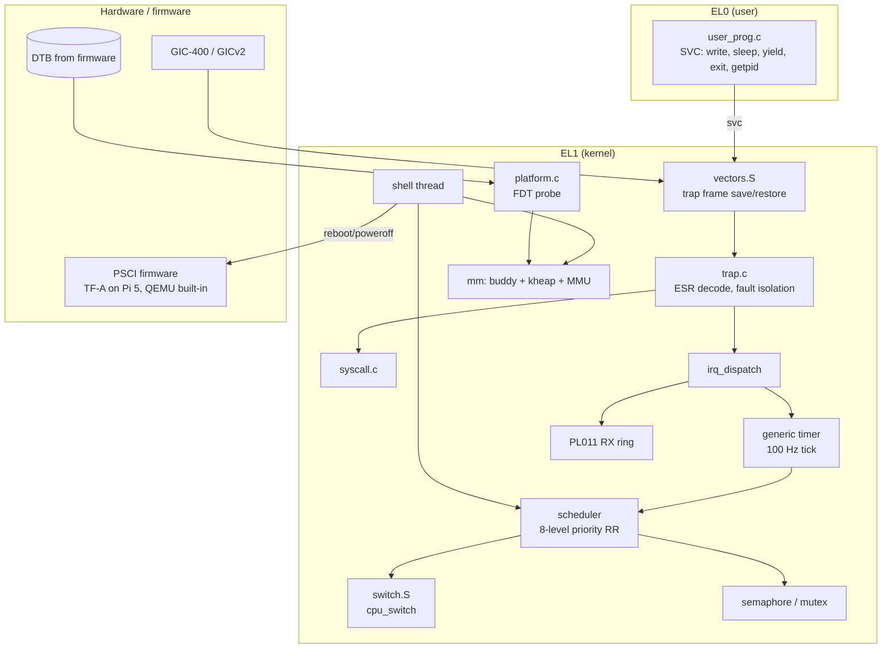
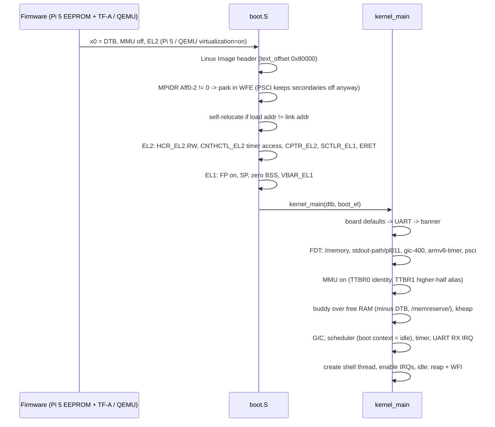

# OrbitOS architecture

OrbitOS is a single-address-space, uniprocessor, preemptive kernel for
AArch64. The current design is a small monolithic kernel. The plan is to
shrink it toward a microkernel (see the roadmap in the README), so the
subsystem boundaries below are drawn where IPC boundaries are expected to go later.

## Layers

| Directory | Contents | Host-tested |
|-----------|----------|-------------|
| `kernel/arch/` | `boot.S` (entry, relocation, EL2→EL1), `vectors.S`, `switch.S`, linker script | no (QEMU/Unicorn) |
| `kernel/core/` | `kernel_main`, console/panic, trap dispatch, syscalls + EL0 tasks, demos, platform probe | no |
| `kernel/drivers/` | PL011, GICv2, generic timer, PSCI | no |
| `kernel/mm/` | `buddy.c`, `kheap.c` (portable), `mm.c` glue, `mmu.c` | buddy, kheap |
| `kernel/sched/` | `runqueue.c` (portable), `sched.c`, `sync.c` | runqueue |
| `kernel/fdt/` | read-only DTB parser | yes |
| `kernel/shell/` | `shell_parse.c` (line editor, tokenizer; portable), `shell.c` | parser |
| `kernel/lib/` | string, printf, ESR decoder, chainloader protocol + CRC-32 | yes |
| `chainloader/` | serial bootloader | protocol logic |

"Portable" files include no hardware headers. They are compiled twice: for
the kernel (`aarch64-freestanding`) and natively for the unit tests in `tests/`.

## Boot flow

With the chainloader, the firmware starts `chainloader.img` instead. It
copies itself to `CHAIN_BASE`, receives the kernel over the UART into the
original load address, and jumps there with the firmware's `x0` (DTB) and
the original exception level. From then on the flow above is identical.

## Exceptions and interrupts

* `vectors.S` has 16 entries. Each saves a 272-byte trap frame (x0-x30,
  SP_EL0, ELR_EL1, SPSR_EL1) on the current thread's kernel stack and calls
  `exception_dispatch(tf, type)`.
* **IRQ** (EL1 or EL0): `GICC_IAR` → timer or UART handler → `GICC_EOIR` →
  `sched_preempt_point()`. A context switch inside the IRQ path is safe
  because every thread has its own kernel stack. The interrupted frame stays
  on the old stack until that thread is switched back in.
* **EL0 sync**: EC 0x15 (SVC64) goes to `syscall_dispatch`. Anything else is
  decoded and printed, and the task is killed.
* **EL1 sync**: decoded (`esr.c` names the class, fault status code, level
  and read/write) and printed with ELR and FAR. If a thread other than
  idle/boot faulted, only that thread is killed. Otherwise the kernel panics.

## Scheduler

* `struct thread` array (32 slots). Each thread has a 16 KiB kernel stack from the
  buddy allocator and a `cpu_ctx` of callee-saved registers, saved and restored
  by `cpu_switch`.
* Run queue: 8 FIFO levels plus a bitmap (`runqueue.c`). Priority 0 is the highest.
  The highest non-empty level runs, and threads in the same level take turns with a
  5-tick (50 ms) slice. A thread that wakes with a higher priority than the running
  thread preempts it at the next preempt point. Priorities are strict, so starvation
  is possible by design for now.
* The idle thread is the boot context. It is never queued and runs only when
  the run queue is empty. It frees zombie stacks and executes `WFI`.
* Sleep uses tick deadlines that `sched_tick()` scans. Semaphores keep FIFO
  wait queues built on the same list node as the run queue. A mutex is a
  binary semaphore plus an owner check.
* EL0 tasks are kernel threads that `eret` to EL0 through `enter_user()`. They
  have a 4 KiB user stack in the `.user.stack` section and run code from the
  `.user` section. Both sections are mapped with EL0 permissions. Address
  spaces are still shared (see roadmap).

## Memory management

See [memory-map.md](memory-map.md) for addresses.

* **Buddy allocator**: orders 0-10 (4 KiB to 4 MiB). It keeps one metadata byte per
  page, and the free lists are stored inside the free pages. Pages start out
  reserved, and only the ranges passed to `buddy_add_range()` become usable,
  which is how the DTB and `/memreserve/` entries are excluded.
* **kheap**: slab-style size classes 16..1024 B carved from single pages (a
  64 B page header holds magic, class and live count). Larger requests get
  2^n pages directly. `kfree()` finds the header by masking the pointer.
  Slab pages are not yet returned to the buddy allocator.
* **MMU**: 4 KiB granule, T0SZ=T1SZ=16 (48-bit), 4 levels. MAIR holds
  Device-nGnRnE, Device-nGnRE, Normal WB and Normal NC. The kernel image is
  mapped with 4 KiB pages so that each section gets its own permissions:

  | Range | EL1 | EL0 |
  |-------|-----|-----|
  | `.text.boot`, `.text` | R-X | --- |
  | `.user` (user code + strings) | R-- (PXN) | R-X |
  | `.rodata` | R-- | --- |
  | `.data`, `.bss`, boot stack | RW- | --- |
  | `.user_stack` | RW- | RW- (XN) |
  | rest of RAM | RW- (2 MiB blocks) | --- |
  | device window | Device-nGnRE, XN | --- |

  TTBR1 maps all RAM again at `0xffff_0000_0000_0000 + PA`. The kernel still
  runs from the identity map. The alias is checked at boot by writing through
  one mapping, reading through the other, and comparing with `AT S1E1R`. This
  is the groundwork for linking the kernel high and handing TTBR0 to
  per-process tables.

## Platform description

`board_<name>.c` holds compile-time defaults. `platform.c` then refines them
from the DTB:

* memory: `/memory` `reg[0]`, translated through any parent `ranges`
* console: `/chosen/stdout-path` (alias names are resolved), accepted only
  if it is a PL011 inside the board's device window. Otherwise the first
  enabled PL011 in that window is used. This rule matters on the Pi 5: its
  `serial0` may point to an RP1 UART behind PCIe, which is not reachable yet.
* GIC: `arm,gic-400` or `arm,cortex-a15-gic`, with `reg[0]` as the
  distributor and `reg[1]` as the CPU interface. GICv3 trees are detected
  and reported as unsupported.
* timer PPI (entry 1 of `arm,armv8-timer`) and the PSCI conduit (`method`).
